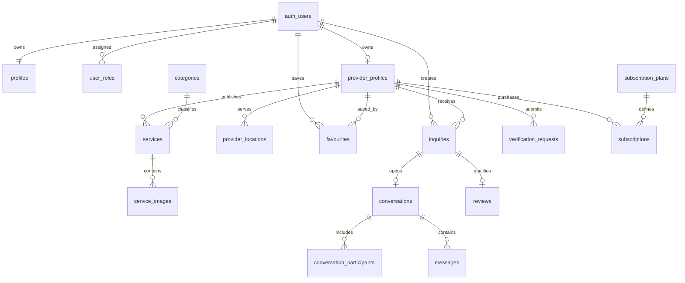

# Trolley architecture and build plan

## Product

Trolley is a services marketplace, not a product-shopping store. Its three connected experiences are **Discover** (customers find professionals), **Grow** (providers manage their businesses) and **Trust** (moderation, privacy and secure interactions).

## Architecture

- **Web:** React + TypeScript + Vite, responsive UI, Lucide icons.
- **Backend:** Supabase Auth, PostgreSQL, RLS, Storage and Edge Functions.
- **Mobile:** Capacitor Android shell using the same web application.
- **Source control/deployment:** GitHub repository; deploy the web build to a static hosting platform and connect production to a separate Supabase project.
- **Payments:** Pesepay through server-side Edge Functions and signed webhooks only. No browser-side merchant secret or trusted redirect confirmation.
- **AI:** Future server-side integration with authorization, input validation and rate limits.

## Data relationships

## Roles and authorization

- **Customer:** own profile, favourites, enquiries and eligible reviews; messages only in conversations they participate in.
- **Provider:** own provider profile, locations, services, enquiries and subscriptions; public profile visibility only after approval.
- **Administrator:** assigned out-of-band through trusted server/database administration. No client role selector or self-promotion.

RLS is enabled on all application tables. Security-definer functions use a fixed `search_path`; sensitive functions require `auth.uid()` and validate ownership. Public listings require an approved and complete provider profile plus a published service. Conversation membership is created through a validated RPC rather than a direct insert policy.

## Category model

The seed contains 51 parent families and 1,020 distinct subcategories (1,071 rows total). UUIDs are deterministic and stable. Categories are taxonomy only; they do not create provider listings.

## Environment

Only the Supabase URL and publishable/anon key are browser variables. Google OAuth client secrets, Supabase service-role keys, Pesepay merchant secrets and AI keys must remain server-side. Use separate development/staging/production projects and secrets.

## Delivery roadmap

1. Foundation, migrations, RLS and design system (current initial build).
2. Complete provider onboarding, provider dashboard, public provider profile and service management.
3. Customer enquiries, secure messaging, favourites, reports and notifications.
4. Quotations, job lifecycle, eligibility-gated reviews and provider analytics.
5. Admin verification/moderation dashboard, audit trails and fraud controls.
6. Subscription lifecycle and Pesepay integration with verified webhooks.
7. Server-side AI assistant, SEO, accessibility/performance testing and CI.
8. Android device testing, release signing, backup/restore drills and production launch review.

## Reference direction

The supplied graphics inform the clean editorial hierarchy, warm neutral surfaces, bold typography, orange callouts, simple comparison cards and explicit privacy/consent/age/subscription disclosures. The supplied videos reinforce secure endpoints, backend-first validation, database access controls and avoiding insecure generated code. The exact source videos are retained outside the app bundle; they are design/engineering references, not runtime dependencies.
